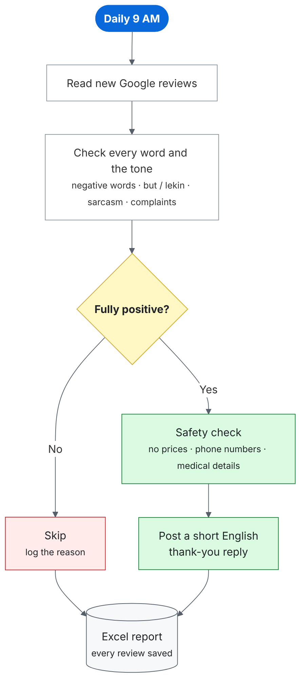

# 🏥 Healthcare Google Review Auto-Reply Bot

  

## The problem

Hospitals get hundreds of Google reviews. Replying to each one by hand is slow, so many happy patients never get a thank-you.

But replying automatically is risky. Many 5★ reviews hide a complaint:

> *"Great doctors… we just had an issue with hygiene."*

A bot that thanks this patient looks careless. Reviews also come in English, Hindi and Hinglish.

## The solution

An **n8n** bot that runs every morning and replies **only when a review is fully positive**. Anything else is skipped and logged.

**Rule:** no negative word + no negative tone + at least one positive word = reply. Stars are ignored.

## Result

Tested on **199 real reviews**: 133 replied, 66 skipped, **0 wrong replies**.

## Try it

1. Install and start n8n: `npm install -g n8n` → `n8n start`
2. Import `workflow/healthcare-google-review-auto-reply-bot.json`
3. Click **Execute workflow** (runs on 20 demo reviews)

Check accuracy: `node scripts/evaluate.js`

## More details

[Case study](docs/CASE_STUDY.md) · [Training](docs/TRAINING.md) · [Execution](docs/EXECUTION.md) · [Pipeline](docs/PROJECT_PIPELINE.md) · [Impact](docs/IMPACT.md)

---

All data here is made-up demo data. · **Tech:** n8n, JavaScript, Google Business Profile API · **License:** MIT © 2026 Rajan Gupta
