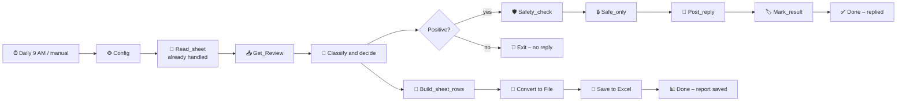

# 🏥 Healthcare Google Review Auto-Reply Bot (n8n)

A self-hosted **n8n** workflow that reads a hospital's Google reviews every morning, **replies only to reviews that are fully positive**, and logs every review to Excel. Reviews in English, Hindi and Hinglish are understood; replies are always in English.

> All data in this repository is **made-up demo data**. The hospital name is a placeholder ("City Care Hospital") and can be changed in the `Config` node.

---

## The rule

| Review | Bot action |
|---|---|
| Every word **and** the tone are positive, and there is at least one positive word | ✅ **Reply** with an English thank-you |
| Any negative word, phrase, or tone (complaint, "but…", suggestion, sarcasm, CAPITALS, worry) | 🚪 **Exit**: no reply, logged only |
| Stars only, no text | 🚪 **Exit** |

Stars are **never** used to decide. A 5★ review with a hidden complaint is exited; when in doubt, the bot stays out.

## Architecture



| Node | What it does |
|---|---|
| Daily 9 AM / Manual test run | Schedule trigger (IST) and a button for testing |
| Config | `mode` (test / live), `hospital_name`, Google `account_id`, `location_id` |
| Read_sheet | Review IDs already handled, so nothing is handled twice |
| Get_Review | Demo: 20 sample reviews. Production: Google Business Profile API |
| Classify and decide | The "brain": word lists + tone checks → Reply / Exit, picks a reply |
| Positive? | Splits Reply and Exit paths |
| Safety_check / Safe_only | Blocks replies containing prices, phone numbers, room numbers, medical words, or bad length |
| Post_reply | Test mode: simulated. Production: posts the reply on Google |
| Build_sheet_rows → Save to Excel | One log row per review, posted or exited |

## How the brain decides

1. **Negative words** (English, Hindi, Hinglish): *rude, dirty, worst, bekar, ghatiya, bakwas…*
2. **Negative phrases:** *"had issue", "not satisfied", "kept waiting", "dhyan nahi", "koi nahi", "2 stars"…*
3. **Contrast words:** *but, however, otherwise, lekin, magar, par*
4. **Tone checks:** shouting in CAPITALS, complaint questions (*"Why is…?"*), suggestions (*"please improve"*), sarcasm (*"thanks for nothing"*), hardship words (*worried, pareshan*), `!!!`
5. **Positive words:** *good, excellent, caring, supportive, accha, badhiya, shukriya…*

Replies come from **100 English templates** grouped by topic (Doctor, Nursing, Emergency, ICU, OPD, International Wing, Facility, Food, Staff, General) and are signed with the hospital name from `Config`.

## Results

- Trained and evaluated on **199 real, labelled reviews** from a private deployment (not included here).
- **97% accuracy, 0 wrong replies** (the bot never replied to a non-positive review).
- On the 20 demo reviews in `data/`: **20 / 20 correct**.

## Training loop

`code/training-node.js` is a separate n8n Code node that scores the word lists against labelled reviews:

1. Add reviews as `['Reply', 'text']` or `['Exit', 'text']`.
2. Execute → row 1 shows total, accuracy and **"bot would WRONGLY reply"** (must be 0).
3. Fix misses by adding words or phrases, re-run, then copy the word lists into `Classify and decide`.

## Run it

1. Install n8n (`npm install -g n8n`) and start it: `n8n start` → open http://localhost:5678
2. **Workflows → Import from File** → `workflow/healthcare-google-review-auto-reply-bot.json`
3. In **Save to Excel**, set a folder n8n is allowed to write to (see `N8N_RESTRICT_FILE_ACCESS_TO`).
4. Click **Execute workflow**: demo reviews flow through, replies are simulated (`mode = test`).

### Connect Google (production)

1. Request **Google Business Profile API** access for your Cloud project (quota changes from 0 to 300 when approved).
2. Create an OAuth client (Web application) with redirect URI `http://localhost:5678/rest/oauth2-credential/callback` and scope `https://www.googleapis.com/auth/business.manage`.
3. Add an **OAuth2 API** credential in n8n and connect the account that manages the business profile.
4. Replace `Get_Review` with an HTTP Request: `GET https://mybusiness.googleapis.com/v4/accounts/{account}/locations/{location}/reviews`
5. Replace `Post_reply` with an HTTP Request: `PUT …/reviews/{reviewId}/reply` with body `{"comment": "<reply>"}`
6. Run 2 weeks in `mode = test`, then switch to `mode = live`.

## Repository

```
workflow/   n8n workflow (import this)
code/       Code-node scripts: brain, safety check, training node, demo data
data/       sample-reviews.json – 20 made-up reviews with labels
```

## Tech stack

n8n (self-hosted) · JavaScript · Google Business Profile API · OAuth2 · Excel

## Next steps

- Compare the rule-based brain with an LLM classifier on the same labelled set
- Google Sheets log and an error-alert workflow
- More Hindi / Hinglish training data

## License

MIT
