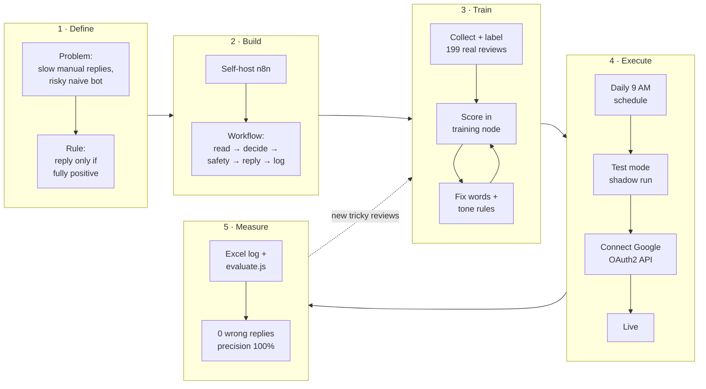
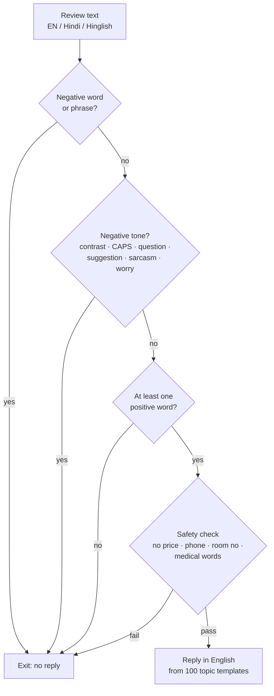
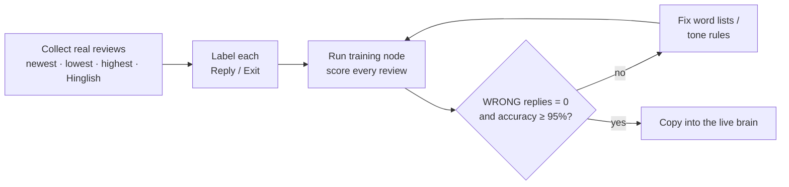
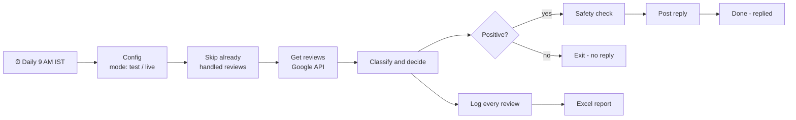

# 🏥 Healthcare Google Review Auto-Reply Bot

     

A self-hosted **n8n** workflow that reads a hospital's Google reviews every morning, **replies only to reviews that are genuinely, fully positive**, and exits on anything else. Trained in rounds on **199 real labelled reviews** until it made **0 wrong replies**.

> All data in this repository is **made-up demo data**. The hospital name is a placeholder (`City Care Hospital`) set in the `Config` node.

**Contents:** [Project flow](#project-flow-end-to-end) · [1. Problem](#1-the-problem) · [2. Approach](#2-cracking-it-the-approach) · [3. Training](#3-training-the-brain) · [4. Execution](#4-execution-how-it-runs) · [5. Results](#5-results) · [Impact](#impact) · [Run it](#run-it-in-5-minutes) · [Case study](docs/CASE_STUDY.md) · [Pipeline](docs/PROJECT_PIPELINE.md)

---

## Project flow (end to end)



| Phase | What happened | Output |
|---|---|---|
| 1 · Define | Studied real reviews; found hidden complaints, Hinglish, sarcasm | One safety rule: reply only if fully positive |
| 2 · Build | Self-hosted n8n; built a 13-node workflow with explicit Done / Exit paths | `workflow/healthcare-google-review-auto-reply-bot.json` |
| 3 · Train | 4 rounds on labelled reviews; every miss fixed and re-tested | Word lists + tone checks in `code/classify-and-decide.js` |
| 4 · Execute | 9 AM schedule, test mode, safety check, Google OAuth2 connection | Shadow run → live |
| 5 · Measure | Every review logged with its reason; reproducible evaluation | 0 wrong replies, precision 100%, recall ≈ 96% |

## 1. The problem

Hospitals receive thousands of Google reviews. Replying by hand is slow, so many happy patients never get a thank-you. But a simple "reply to every 4★–5★ review" bot is **dangerous in healthcare**:

| Real-world pattern | Example | Naive bot |
|---|---|---|
| Complaint hidden in a 5★ review | *"Great doctors… we just had an issue with hygiene. Otherwise great service."* | ❌ thanks an unhappy patient |
| Praise hidden in a 2★ review | *"The 2 stars I'm giving are only because of the doctors."* | ❌ misreads the tone |
| Hinglish | *"Doctor accha tha lekin nurses ne dhyan nahi diya."* | ❌ misses "lekin… dhyan nahi" |
| Sarcasm / shouting | *"Thanks for nothing at billing."* · *"STAFF IS VERY RUDE"* | ❌ sees "thanks" |
| Complaint with no "bad" word | *"Room rent is 10,000 per day and there are termites."* | ❌ nothing negative to catch |

**Goal:** reply automatically **only** when the words *and* the tone are fully positive; never reply to a complaint. Free tools only, data stays on the hospital's own machine.

## 2. Cracking it: the approach

**One rule, tuned for safety:**

> **No negative word + no negative tone + at least one positive word = Reply. Anything else = Exit.**
> Stars are ignored. When in doubt, the bot stays out.



Why rules and not a model first? In a hospital the cost of one wrong public reply is far higher than a missed thank-you, so the system had to be **explainable** (every Exit records *why*) and **measurable** against labelled data before anything went live.

## 3. Training the brain

The "brain" is word lists + tone checks in one n8n Code node. It was trained like a model: labelled data, a score, and fix-and-re-test rounds.



| Round | Labelled reviews | Accuracy | Wrong replies | What the bot learned |
|---|---|---|---|---|
| 1 | 55 | 100% | 0 | base word lists; "no" before a number isn't negation |
| 2 | 145 | 95% → **99%** | 1 → **0** | "2 stars", "only because", cheaters, incompetent, inept |
| 3 | 201 | 93% → **97%** | 2 → **0** | "had issue", "otherwise", "needs some"; "room no" isn't negation |
| 4 | 214 | 97% | **0** | CAPITALS, complaint questions, suggestions, sarcasm, hardship, Hinglish negatives |

Full method: **[docs/TRAINING.md](docs/TRAINING.md)**

## 4. Execution: how it runs



- **Test mode first:** replies are simulated and logged; switch `mode` to `live` only after a 2-week shadow run with 0 wrong replies.
- **Every review is logged** with its decision, reason (`Why exited`) and the reply, so non-technical staff can audit it.
- **Explicit end nodes** (`Done – replied`, `Exit – no reply`, `Done – report saved`) make every path visible on the canvas.

Full runbook: **[docs/EXECUTION.md](docs/EXECUTION.md)**

## 5. Results

On **199 unique real reviews** (private deployment, not included):

| Metric | Result |
|---|---|
| Reviews replied / exited | 133 / 66 |
| **Wrong replies** (replied to a non-positive review) | **0** |
| Precision for "Reply" | **100%** |
| Recall for "Reply" (good reviews that got a reply) | ≈ 96% |
| Replies blocked by the safety check | 0 |

The remaining misses are all on the **safe side**, e.g. *"my condition was very bad but after treatment I recovered"* is exited rather than risk a wrong reply.

Reproduce on the demo data:

```bash
node scripts/evaluate.js
```
```
                 bot: Reply   bot: Exit
truth: Reply           8           0
truth: Exit            0          12
Accuracy           : 100.0%
Precision (Reply)  : 100.0%
WRONG replies      : 0
```

## Impact

### For the hospital

| Area | Before | With the bot |
|---|---|---|
| Staff time | Every positive review answered by hand | **~2 in 3 reviews** (133 of 199 in testing) answered automatically; staff only see the rest |
| Reply speed | Days, or never | Every morning at **9 AM**, within 24 hours |
| Coverage | Many happy patients never thanked | **Every** fully positive review gets a reply |
| Safety | Risk of thanking an unhappy patient | **0 wrong replies**; complaints never get a canned thank-you |
| Brand voice | Varied by who replied | 100 approved templates, one consistent voice |
| Insight | Complaints scattered across Google | Every exited review logged with its reason (billing, waiting, hygiene…) |
| Software cost | — | **₹0**: self-hosted n8n + free Google API |

*Estimate:* at ~2 minutes per manual reply, the bot saves about **3 staff-hours per 100 positive reviews**. Post-launch KPIs: reply coverage, time-to-reply, wrong replies (must stay 0), rating and review-count trend over 3–6 months.

### Skills demonstrated

| Skill | Evidence |
|---|---|
| Problem framing in a high-risk domain | Optimised for the costly error (zero false replies), not raw coverage |
| Workflow automation (n8n) | Schedule trigger, Code nodes, IF routing, file I/O, OAuth2, test/live config, explicit end nodes |
| NLP on messy real data | English + Hindi + Hinglish, negation, contrast words, sarcasm, hidden complaints |
| ML-style evaluation | Labelled set, training rounds, confusion matrix, precision / recall, reproducible `evaluate.js` |
| Safety & governance | Pre-post safety filter, audit log with reasons, shadow run before go-live, secrets kept out of code |
| API integration | Google Business Profile API via OAuth2 |
| Documentation | Case study, training method, execution runbook, diagrams |

## Run it in 5 minutes

1. Install n8n: `npm install -g n8n` → `n8n start` → open http://localhost:5678
2. **Workflows → Import from File** → `workflow/healthcare-google-review-auto-reply-bot.json`
3. In **Save to Excel**, set a folder n8n may write to (see `N8N_RESTRICT_FILE_ACCESS_TO`).
4. **Execute workflow**: 20 demo reviews → 8 replied (simulated), 12 exited, Excel report saved.

Connecting the real Google Business Profile API is covered in [docs/EXECUTION.md](docs/EXECUTION.md#connect-google).

## Repository

```
workflow/   n8n workflow – import this
code/       Code-node scripts: brain, safety check, training node, log builder, demo reviews
scripts/    evaluate.js – reproducible evaluation (confusion matrix, precision, recall)
data/       sample-reviews.json – 20 made-up labelled reviews
docs/       CASE_STUDY.md · TRAINING.md · EXECUTION.md · PROJECT_PIPELINE.md
```

## What I learned

- **Optimise for the costly error.** Zero wrong replies mattered more than replying to everyone.
- **Stars lie; words and tone don't.** Hidden complaints were the main risk.
- **Measure every change.** A labelled set and one safety metric turned guesswork into engineering.
- **Make automation auditable** for non-technical users: reasons, logs, test mode, visible exits.

## Next steps

- Hybrid AI: keep rules for clear cases, send only unclear reviews to an LLM; compare both on the same labelled set
- Google Sheets log and error-alert workflow
- More Hindi / Hinglish data

## License

MIT © 2026 Rajan Gupta
