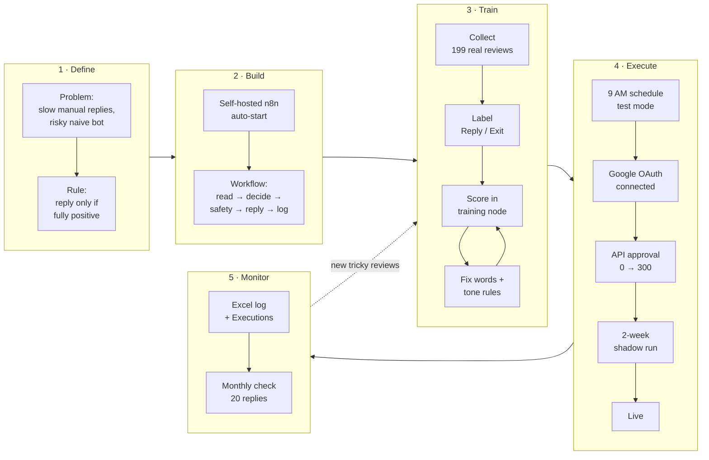
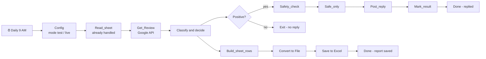
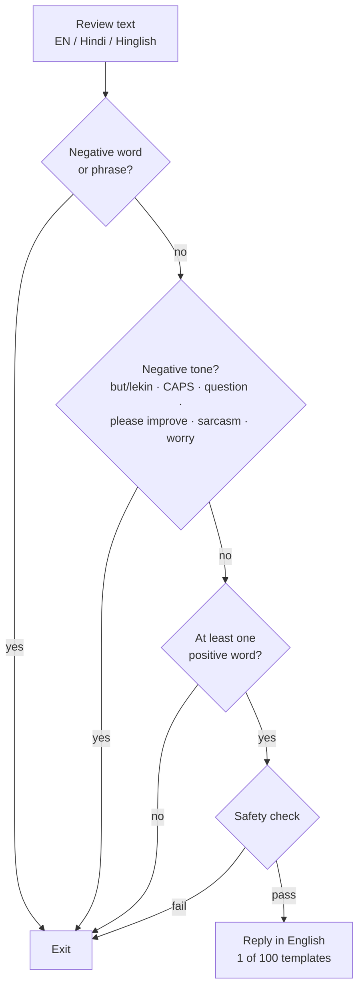
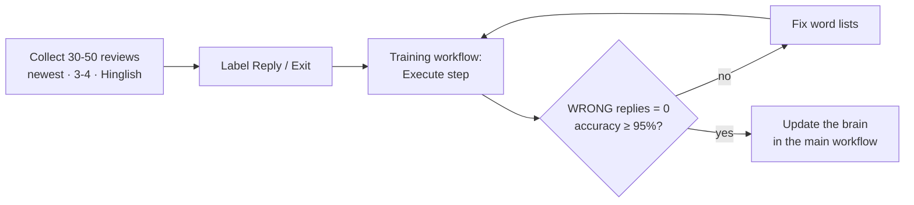

# Project pipeline – Healthcare Google Review Auto-Reply Bot

## 1. End-to-end pipeline

| Phase | Dates | Status |
|---|---|---|
| 1 · Define | Week 1 | ✅ Problem and rule agreed |
| 2 · Build | Week 1 | ✅ n8n installed, workflow built |
| 3 · Train | Week 1–2 | ✅ 199 real reviews, 0 wrong replies |
| 4 · Execute | Week 2 → | ✅ schedule, test mode, OAuth · ⏳ API approval, shadow run, live |
| 5 · Monitor | after go-live | ⏳ |

## 2. Daily run (9:00 AM IST)

## 3. How one review is decided

## 4. Training loop

| Round | Reviews | Accuracy | Wrong replies |
|---|---|---|---|
| 1 | 55 | 100% | 0 |
| 2 | 145 | 99% | 1 → 0 |
| 3 | 201 | 97% | 2 → 0 |
| 4 (tone) | 214 | 97% | 0 |
| v6 | 199 real | 133 Reply / 66 Exit | 0 |

## 5. Go-live path

| Stage | Config | Exit criteria |
|---|---|---|
| Local test | `mode = test`, demo reviews | ✅ all paths green |
| Shadow run | `mode = test`, real Google reviews | 2 weeks, ≥ 100 reviews, 0 wrong replies (check Excel daily) |
| Live | `mode = live` | Monthly check of 20 replies; any wrong reply → back to test |

## 6. What changes at the API step

| Box | Now | After approval |
|---|---|---|
| Get_Review | 199 test reviews | `GET mybusiness.googleapis.com/v4/accounts/{a}/locations/{l}/reviews` |
| Post_reply | Simulated | `PUT …/reviews/{reviewId}/reply` |
| Config | IDs empty | account_id, location_id filled |
| Everything else | — | No change |
